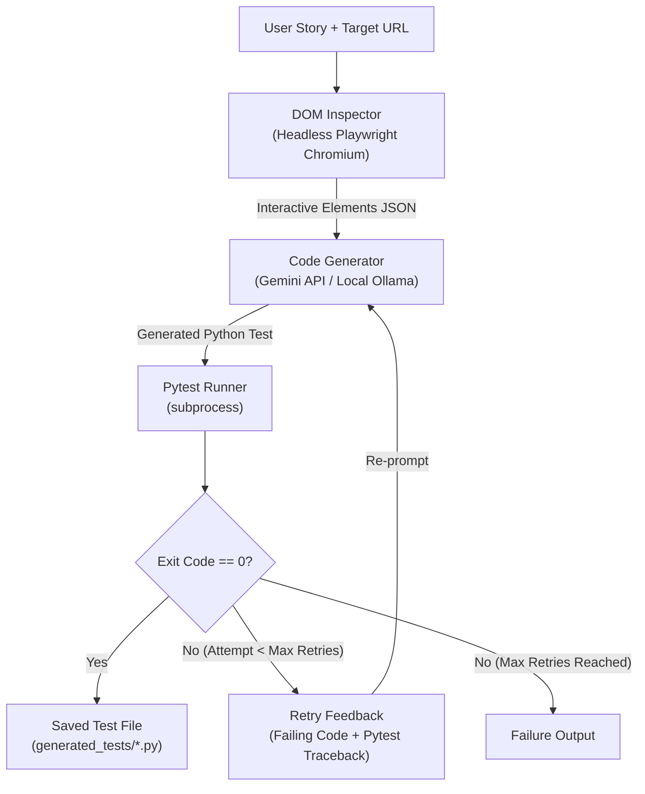

# Spec-to-Playwright Agent (Experimental Prototype)


An experimental proof-of-concept exploring LLM-driven `pytest-playwright` test generation from natural-language user stories, live DOM snapshots, and iterative retry feedback.

---

## Overview & Motivation

This prototype investigates the practical mechanics and trade-offs of using LLMs to generate and repair UI automation tests:

1. **DOM Extraction (`tools/dom_inspector.py`)**: Launches a headless Chromium browser via Playwright, loads a single target URL, and extracts a filtered JSON list of visible interactive elements (`button`, `input`, `a`, `select`, `textarea`, `form`, and basic ARIA roles) along with attributes like `id`, `name`, `placeholder`, `role`, and `data-testid`/`data-test`. Reducing the raw HTML to interactive nodes keeps prompt context small.
2. **Code Generation (`agent/code_generator.py`)**: Sends the extracted DOM JSON and user story to either **Google Gemini (`gemini-2.5-flash`)** or a local **Ollama** model (`phi3`, `llama3`, etc.) to synthesize a single-file Python `pytest-playwright` test using a Page Object class.
3. **Subprocess Test Runner (`tools/test_runner.py`)**: Writes the generated Python code to disk and runs `pytest` in a subprocess, capturing exit codes, `stdout`, and `stderr`.
4. **Iterative Retry Loop (`agent/orchestrator.py`)**: When a generated test fails, the orchestrator appends the failing code and `pytest` traceback to the next prompt (up to `max_retries` attempts) so the model can attempt to fix syntax errors, bad selector calls, or failed assertions.

### Current Scope & Trade-offs
- **Single-page DOM snapshot**: The DOM inspector currently captures the initial page state before user interaction. Multi-step flows across pages rely on URL/state assertions or known target paths unless inspected at each step.
- **Model sensitivity**: Smaller local models (e.g., 3.8B parameter models via Ollama) require explicit prompt constraints to avoid hallucinating Playwright API signatures, whereas larger cloud models handle complex selectors more reliably.
- **Related project**: This prototype explores test authoring alongside [`smart-triage-rag`](https://github.com/anishassoun/smart-triage-rag), another experimental project focused on RAG-assisted test failure log analysis.

---

## Architecture



---

## Project Structure

```text
autonomous-playwright-agent/
├── agent/
│   ├── __init__.py
│   ├── code_generator.py              # Prompt construction & Gemini / Ollama calls
│   └── orchestrator.py                # Retry loop coordinating inspection, generation, and test runs
├── tools/
│   ├── __init__.py
│   ├── dom_inspector.py               # Playwright script extracting visible interactive elements
│   └── test_runner.py                 # Subprocess wrapper around pytest
├── generated_tests/
│   └── test_saucedemo_login.py        # Example output from running against saucedemo.com
├── main.py                            # CLI entry point
├── requirements.txt                   # Python dependencies
├── .env.example                       # Environment variable template
├── LICENSE                            # MIT License
└── README.md
```

---

## Setup

### 1. Clone & Create Virtual Environment

```bash
git clone https://github.com/anishassoun/autonomous-playwright-agent.git
cd autonomous-playwright-agent

python -m venv .venv
# Windows (PowerShell)
.venv\Scripts\Activate.ps1
# macOS / Linux
source .venv/bin/activate
```

### 2. Install Dependencies & Chromium

```bash
pip install -r requirements.txt
playwright install chromium
```

### 3. Configure Environment Variables (`.env`)

Copy `.env.example` to `.env`:

```bash
cp .env.example .env
```

Choose either Google Gemini or a local Ollama server:

- **Google Gemini**:
  ```env
  GEMINI_API_KEY=your_actual_gemini_api_key
  GEMINI_MODEL=gemini-2.5-flash
  ```
- **Local Ollama** (used when `GEMINI_API_KEY` is omitted or left as `your_key_here`):
  ```env
  GEMINI_API_KEY=your_key_here
  OLLAMA_MODEL=phi3:latest
  OLLAMA_URL=http://localhost:11434/api/generate
  ```

---

## Usage

### Run Default Example (SauceDemo Login)

```bash
python main.py
```

### Run with Custom Arguments

```bash
python main.py \
  --url "https://www.saucedemo.com/" \
  --story "Log in with username 'standard_user' and password 'secret_sauce', and verify that after login the user is redirected to the inventory page ('/inventory.html')" \
  --output "generated_tests/test_saucedemo_login.py" \
  --retries 3
```

### Run DOM Inspector Standalone

```bash
python tools/dom_inspector.py https://www.saucedemo.com/
```

---

## Sample Output

Console output from a run against `https://www.saucedemo.com/`:

```text
======================================================================
🚀 Starting Autonomous Spec-to-Playwright Agent
🔗 Target URL : https://www.saucedemo.com/
📋 User Story : Log in with username 'standard_user' and password 'secret_sauce', and verify that after login the user is redirected to the inventory page ('/inventory.html')
💾 Output File: generated_tests/test_saucedemo_login.py
======================================================================

[1/4] Inspecting DOM for interactive elements...
      DOM snapshot captured successfully.

[2/4] Generating Playwright POM test (Attempt 1/3)...
[3/4] Executing test 'generated_tests/test_saucedemo_login.py' with pytest (Attempt 1/3)...

[4/4] [SUCCESS] Test passed on attempt 1!

--- Pytest Output ---
.                                                                        [100%]
1 passed in 1.15s

======================================================================
✅ Agent finished successfully in 1 attempt(s)! Saved to: generated_tests/test_saucedemo_login.py
```

Example generated test (`generated_tests/test_saucedemo_login.py`):

```python
import re
from playwright.sync_api import Page, expect


class SauceDemoPage:
    def __init__(self, page: Page):
        self.page = page
        self.username_input = page.locator("#user-name")
        self.password_input = page.locator("#password")
        self.login_button = page.locator("#login-button")

    def navigate(self):
        self.page.goto("https://www.saucedemo.com/")

    def login(self, username: str, password: str):
        self.username_input.fill(username)
        self.password_input.fill(password)
        self.login_button.click()


def test_login_and_redirect(page: Page):
    pom = SauceDemoPage(page)
    pom.navigate()
    pom.login("standard_user", "secret_sauce")
    expect(page).to_have_url(re.compile(r".*/inventory.html"))
```

---

## License

MIT License — see [LICENSE](LICENSE).
