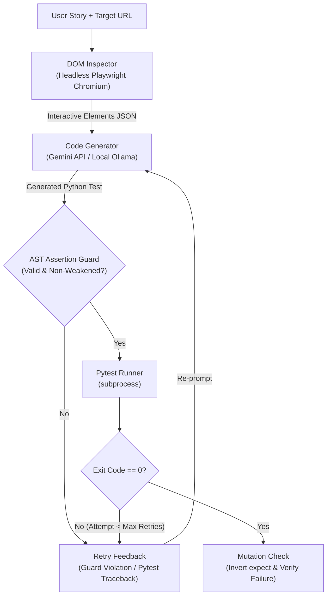

# Spec-to-Playwright Agent (Experimental Prototype)


An experimental proof-of-concept exploring LLM-driven `pytest-playwright` test generation, iterative self-healing from `pytest` tracebacks, and static/dynamic safeguards against assertion weakening.

---

## Overview & Motivation

This prototype investigates the mechanics, failure modes, and engineering trade-offs of using LLMs to generate and repair UI automation tests from natural-language user stories:

1. **DOM Extraction (`tools/dom_inspector.py`)**: Launches a headless Chromium browser via Playwright, loads a target URL, and extracts a filtered JSON list of visible interactive elements (`button`, `input`, `a`, `select`, `textarea`, `form`, and basic ARIA roles) along with attributes like `id`, `name`, `placeholder`, `role`, `checked`, `options`, and `data-testid`/`data-test`. Filtering out layout and styling markup keeps prompt context compact.
2. **Code Generation (`agent/code_generator.py`)**: Sends the extracted DOM JSON and user story to either **Google Gemini (`gemini-2.5-flash`)** or a local **Ollama** model (`phi3:latest`, `llama3`, etc.) to synthesize a standalone Python `pytest-playwright` test structured around a Page Object class.
3. **AST Assertion Guard (`agent/assertion_guard.py`)**: Statically parses the generated Python AST before running `pytest` to verify that every `test_*` function contains a genuine Playwright `expect(...)` or comparison assertion—and that retry attempts do not delete or weaken the initial assertion.
4. **Subprocess Test Runner (`tools/test_runner.py`) & Retry Loop (`agent/orchestrator.py`)**: Executes `pytest` in a subprocess and feeds failure tracebacks back to the generator up to `max_retries` times.

---

## How We Prevent Assertion Weakening (AST Guard + Mutation Testing)

A known failure mode of self-healing test agents is **reward hacking / assertion weakening**: when a generated test fails on Attempt 1, an unconstrained LLM can make Attempt 2 pass simply by deleting `expect(...)`, replacing it with `assert True`, or loosening the expected URL/text to an empty wildcard (`r".*"`).

To prevent this, the prototype enforces two complementary checks:

1. **Static AST Assertion Guard (`agent/assertion_guard.py`)**:
   - Parses every generated test file with Python's `ast` module before `pytest` runs.
   - Rejects any `test_*` function that lacks a recognized Playwright `expect(...)` matcher (`to_have_url`, `to_contain_text`, `to_be_checked`, `to_have_value`, etc.) or uses tautological assertions (`assert True`, `assert 1 == 1`, `pass`).
   - Captures the baseline `expect(...)` calls from Attempt 1 and blocks any subsequent self-healing attempt that drops `expect(...)`, reduces assertion count, or replaces expected values with permissive wildcards (`""`, `re.compile(r".*")`).
2. **Automated Mutation Verification (`benchmark/run_benchmark.py` + `mutate_test_assertion`)**:
   - After a test passes `pytest`, the benchmark suite automatically generates a **mutant copy** of the test where the expected outcome inside `expect(...)` is inverted or corrupted (e.g., flipping `.to_be_checked()` $\rightarrow$ `.not_to_be_checked()` or replacing the expected URL/text literal with `"__MUTATED_IMPOSSIBLE_EXPECTED_VALUE_99999__"`).
   - It executes `pytest` on the mutant and verifies that the mutated test **fails** (mutant killed), confirming that the test genuinely evaluates application state.

---

## Multi-Site Benchmark & Mutation Results

Evaluated across **8 user stories** spanning `https://www.saucedemo.com/` and `https://the-internet.herokuapp.com/` (`/login`, `/checkboxes`, `/dropdown`) using local Ollama (`phi3:latest`), including 2 deterministic fault-injection scenarios (`S4` and `S6`) seeded with stale selectors on Attempt 1:

| ID | Story | Target Site | 1st Attempt | Self-Healed on Retry | AST Guard | Mutation Check Failed as Expected | Time (s) |
| :--- | :--- | :--- | :--- | :--- | :--- | :--- | :--- |
| S1 | SauceDemo Valid Login | `saucedemo.com` | Pass (1/1) | N/A (Passed 1st) | Pass | Yes (Mutant Failed) | 9.08s |
| S2 | SauceDemo Locked Out User Error | `saucedemo.com` | Pass (1/1) | N/A (Passed 1st) | Pass | Yes (Mutant Failed) | 5.93s |
| S3 | SauceDemo Empty Username Validation | `saucedemo.com` | Pass (1/1) | N/A (Passed 1st) | Pass | Yes (Mutant Failed) | 8.24s |
| S4 | SauceDemo Stale Button Selector (Self-Heal) | `saucedemo.com` | Fail (Seeded Stale Selector) | Yes (Attempt 2) | Pass | Yes (Mutant Failed) | 58.0s |
| S5 | HerokuApp Form Auth Valid Login | `the-internet.herokuapp.com/login` | Pass (1/1) | N/A (Passed 1st) | Pass | Yes (Mutant Failed) | 29.6s |
| S6 | HerokuApp Stale Input Selector (Self-Heal) | `the-internet.herokuapp.com/login` | Fail (Seeded Stale Selector) | Yes (Attempt 3) | Pass | Yes (Mutant Failed) | 89.57s |
| S7 | HerokuApp Checkboxes Toggle | `the-internet.herokuapp.com/checkboxes` | Pass (1/1) | N/A (Passed 1st) | Pass | Yes (Mutant Failed) | 29.4s |
| S8 | HerokuApp Dropdown Selection | `the-internet.herokuapp.com/dropdown` | Pass (1/1) | N/A (Passed 1st) | Pass | Yes (Mutant Failed) | 54.24s |

### Self-Healing Console & Traceback Log (Scenario S4: Stale Selector Recovery)

In Scenario **S4**, Attempt 1 uses a broken selector `#login-btn-stale`. `pytest` fails with a `TimeoutError`, the orchestrator feeds the traceback + live DOM JSON back to the LLM, and Attempt 2 repairs the selector to `#login-button` while preserving `expect(page).to_have_url(re.compile(r'.*/inventory.html'))`:

```text
[1/4] Inspecting DOM for interactive elements...
      DOM snapshot captured successfully.

[2/4] Generating Playwright POM test (Attempt 1/3)...
[3/4] Executing test 'generated_tests/bench_s4_saucedemo_healed.py' with pytest (Attempt 1/3)...

[4/4] [SELF-HEAL] Attempt 1 failed (exit code 1).
      Feeding pytest traceback back to the Agent for self-healing...

--- Attempt 1 Pytest Traceback ---
generated_tests\bench_s4_saucedemo_healed.py:19: in test_user_story
    page.locator("#login-btn-stale").click(timeout=2000)
E   playwright._impl._errors.TimeoutError: Locator.click: Timeout 2000ms exceeded.
E   Call log:
E     - waiting for locator("#login-btn-stale")

[2/4] Generating Playwright POM test (Attempt 2/3)...
[3/4] Executing test 'generated_tests/bench_s4_saucedemo_healed.py' with pytest (Attempt 2/3)...

[4/4] [SUCCESS] Test passed on attempt 2 (AST Assertion Guard verified 1 assertion(s))!
```

Healed code produced on Attempt 2 (`generated_tests/bench_s4_saucedemo_healed.py`):

```python
import re
from playwright.sync_api import Page, expect


class PageObject:
    def __init__(self, page: Page):
        self.page = page

    def navigate(self, url: str):
        self.page.goto(url)


def test_user001(page: Page):
    pom = PageObject(page)
    pom.navigate("https://www.saucedemo.com/")
    page.locator("#user-name").fill("standard_user")
    page.locator("#password").fill("secret_sauce")
    page.locator("#login-button").click()
    expect(page).to_have_url(re.compile(r'.*/inventory.html'))
```

---

## Architecture



---

## Current Scope & Trade-offs
- **Single-page DOM snapshot**: The DOM inspector captures the initial page state prior to multi-page navigation. Multi-step flows across pages rely on URL/state expectations unless inspected per step.
- **Model sensitivity**: Small local models (`phi3:latest` 3.8B) are sensitive to context window size (`num_ctx=2048`) and prompt formatting compared to larger hosted models (`gemini-2.5-flash`).
- **Related project**: Explores test generation alongside [`smart-triage-rag`](https://github.com/anishassoun/smart-triage-rag), which focuses on RAG-based failure log triage.

---

## Project Structure

```text
autonomous-playwright-agent/
├── agent/
│   ├── __init__.py
│   ├── assertion_guard.py             # AST static check & mutation test generator
│   ├── code_generator.py              # Prompt construction & Gemini / Ollama calls
│   └── orchestrator.py                # Retry loop coordinating inspection, AST guard, and pytest
├── tools/
│   ├── __init__.py
│   ├── dom_inspector.py               # Playwright script extracting visible interactive elements
│   └── test_runner.py                 # Subprocess wrapper around pytest
├── tests/
│   └── test_agent_unit.py             # Fast unit tests for AST guard, DOM inspector, and prompts
├── benchmark/
│   ├── run_benchmark.py               # 8-story multi-site runner + mutation verification
│   └── results.md                     # Generated benchmark report
├── generated_tests/                   # Generated Playwright POM test files
├── main.py                            # CLI entry point
├── requirements.txt                   # Python dependencies
├── .env.example                       # Environment variable template
├── LICENSE                            # MIT License
└── README.md
```

---

## Setup & Usage

### 1. Create Virtual Environment & Install Dependencies

```bash
python -m venv .venv
# Windows (PowerShell)
.venv\Scripts\Activate.ps1
# macOS / Linux
source .venv/bin/activate

pip install -r requirements.txt
playwright install chromium
cp .env.example .env
```

### 2. Run Unit Tests

```bash
pytest tests/test_agent_unit.py -v
```

### 3. Run the Agent CLI

```bash
python main.py
```

### 4. Run the 8-Story Multi-Site Benchmark

```bash
python -m benchmark.run_benchmark
```

---

## License

MIT License — see [LICENSE](LICENSE).
